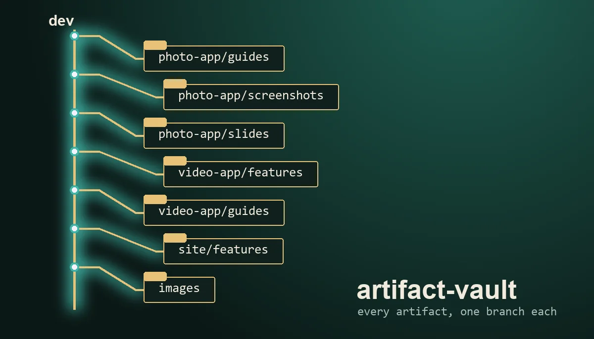

# artifact-vault



Agent skill: save every Claude artifact into one private git repo, one branch per app and kind, then search it and compare it against your current session, a feature list or an uploaded file.

An agent skill from [VIOLINET Tech](https://github.com/Violinet-tech), version 1.0.0. It is a folder with a `SKILL.md` and a zero-dependency Node script (`scripts/vault.mjs`, Node 18+ and git). It works in Claude Code and any harness that reads the `SKILL.md` format, and the markdown reads as plain docs without an agent.

Page: https://violinet-tech.github.io/artifact-vault/ · [Slides](https://violinet-tech.github.io/artifact-vault/slides.html) · [User guide](docs/USER-GUIDE.md)

## Use it when

you want to save, back up or organise Claude artifacts, find an old deck, guide, screenshot or generated picture, or check whether something is already written down.

## What it does

```
dev                      README.md + index.json (the table of contents)
<app>/features           status reports, plans, changelogs, explainers
<app>/guides             user guides, setup guides, runbooks
<app>/screenshots        screenshot pages, plus pictures pulled out of other pages
<app>/slides             decks
<app>/docs               Docs artifacts
images                   generated test pictures, <app>/<what the test was>/
```

- **Save**: Claude lists and downloads your artifacts with the Artifact tool; `vault.mjs ingest` sorts them into branches with plain git plumbing (no checkout), idempotently. A changed kind moves the folder.
- **Keys**: Google, Anthropic, OpenAI, GitHub, Hugging Face, Slack, AWS, Stripe live keys and private key blocks are replaced with `REDACTED_<KIND>` in the saved copy and reported by kind, never printed.
- **Search**: `search <vault> images|slides|features|guides|screenshots|docs|all [words]`, `list`, `show`, `get`.
- **Compare**: `compare --features "a; b"`, `--session summary.txt`, `--upload file.html`, and `unsaved --list list.txt` against the live artifact list.
- **Other**: `stats`, `gaps`, `dupes`, `scan`, `index`, `push` (never forced).

Compare matches words, not meaning, and says nothing about whether a feature works.

## Install

```bash
git clone https://github.com/Violinet-tech/artifact-vault ~/.claude/skills/artifact-vault
```

For one project only, clone into `.claude/skills/artifact-vault`. As part of the whole set: `/plugin marketplace add Violinet-tech/violet-skills`.

Check it works: `node scripts/selftest.mjs` builds a throwaway vault from made-up artifacts and runs every command.

## What's inside

- `SKILL.md`: the skill
- `scripts/vault.mjs`: the command-line tool
- `scripts/selftest.mjs`: the self-test
- `docs/USER-GUIDE.md`, `docs/slides.html`: guide and deck

## More skills

See [all VIOLINET Tech skills](https://github.com/orgs/Violinet-tech/repositories?q=topic%3Aagent-skills).

## Contributing

Issues and PRs welcome. Keep it generic: no personal paths, keys or machine addresses.

## License

MIT, see [LICENSE](LICENSE).
